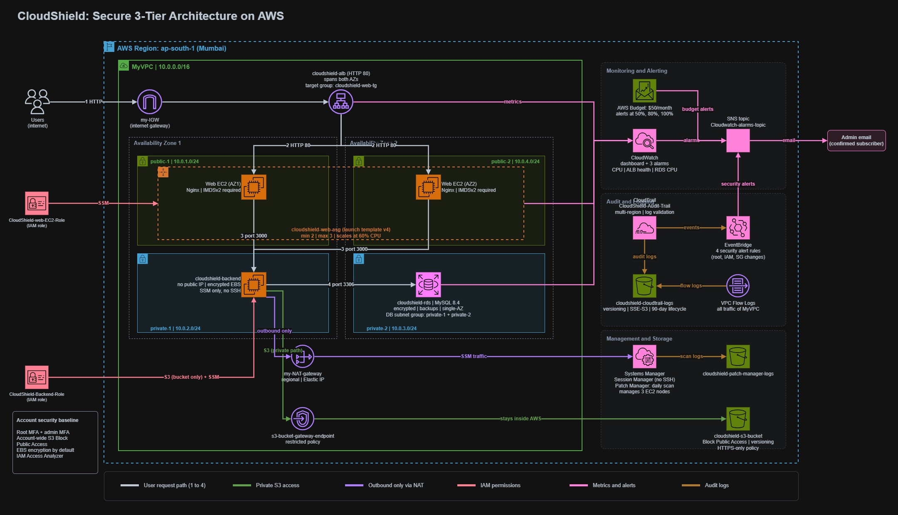

# CloudShield | AWS Cloud Security Architecture

**A secure, resilient, three-tier AWS infrastructure design focused on network isolation, access control, monitoring, and operational security.**

## Architecture Overview

CloudShield demonstrates the design and integration of AWS services to support secure infrastructure deployment, controlled communication between application tiers, high availability, and centralized monitoring.

### Key Components

- **Network Security:** Amazon VPC, public and private subnets, security groups, Internet Gateway, and NAT Gateway.
- **High Availability:** Application Load Balancer and Auto Scaling across multiple Availability Zones.
- **Compute and Data:** Amazon EC2, Amazon RDS, and Amazon S3.
- **Identity and Access:** AWS IAM roles and policies.
- **Monitoring and Operations:** Amazon CloudWatch, AWS CloudTrail, AWS Systems Manager, Amazon SNS, and Amazon EventBridge.

## Project Demonstration

**[▶ Watch the CloudShield Walkthrough on Vimeo](https://bit.ly/CloudShield-Full-Walkthrough)**

The video presents the project architecture, implementation, and key configuration decisions.

## Project Documentation

The repository includes detailed, phase-wise documentation covering the implementation process, configuration steps, screenshots, and troubleshooting.

Explore the PDF files in the repository to review each phase and its corresponding evidence.

---

**Project Focus:** AWS Cloud Security · Infrastructure Architecture · Network Security · IAM · Monitoring and Operations
